### `kushagra@github ~ $ ./contributions.sh`

  

### `kushagra@github ~ $ whoami`

<table>
<tr>
<td valign="top"></td>
<td valign="top"></td>
</tr>
</table>

**Software development · Mobile apps · Competitive programming**

[Email](mailto:ks487013@gmail.com) · [LinkedIn](https://linkedin.com/in/kushagra-sharma-b0118b261) · [Codolio](https://codolio.com/profile/kushagrasharma17)

### `~ $ cat about.txt`

I'm **Kushagra Sharma**, an Electronics & Communication Engineering student at **IIIT Bhopal**. I'm working on backend development, Kotlin Multiplatform, and advanced data structures and algorithms.

Previously, as an **SDE Intern at Xelron (February–May 2026)**, I evaluated AI-generated code, reviewed diffs and tests, and investigated bugs and edge cases.

Open to opportunities in iOS development, cross-platform mobile development, and software engineering.

### `~ $ ls projects/`

| Project | What I built | Stack |
| --- | --- | --- |
| **CryptoVision** | Cryptocurrency portfolio analytics and price tracking | SwiftUI, Firebase, Core Data, Combine |
| **FreshCart** | A native iOS shopping app with a complete checkout flow | SwiftUI, MVVM |
| **StaffSync** | Cross-platform employee attendance management | Kotlin Multiplatform, Compose, Firebase |

### `~ $ cat stack.txt`

- **Languages:** C, C++, Python, Swift, Kotlin, Java, JavaScript
- **Mobile:** SwiftUI, Jetpack Compose, Flutter, React Native
- **Data:** Firebase, MySQL, Core Data
- **Architecture:** MVVM, MVC, Clean Architecture, dependency injection
- **Tools:** Git, GitHub Actions, Xcode, Android Studio, Postman, Linux

### `~ $ open practice/`

[LeetCode](https://leetcode.com/u/kushagra_1710/) · [Codeforces](https://codeforces.com/profile/kushagra_1710) · [CodeChef](https://www.codechef.com/users/ks_17) · [GeeksforGeeks](https://www.geeksforgeeks.org/profile/ks4878h47) · [Code360](https://www.naukri.com/code360/profile/cefee105-b683-4adf-afda-70ce453fc747)

How this profile works

The images are self-contained animated SVGs committed to this repository. GitHub Actions refreshes the public contribution calendar and ASCII portrait daily. No personal access token or external stats-image service is required; committing uses the workflow's built-in `GITHUB_TOKEN`.

The portrait uses my GitHub avatar. To use a different photo, run `python scripts/build_profile.py --photo path/to/photo.jpg` after installing Pillow, and adapt the workflow to use that source. A cropped, high-contrast photo with a simple background works best.

Edit `scripts/build_profile.py` to update the info card. To regenerate local placeholder previews without network access, run `python scripts/build_profile.py --offline`. See [SETUP.md](./SETUP.md).

Inspired by [Avi Vashishta's animated GitHub profile guide](https://www.avivashishta.com/blog/build-animated-github-profile-readme). Implementation written for this profile.

